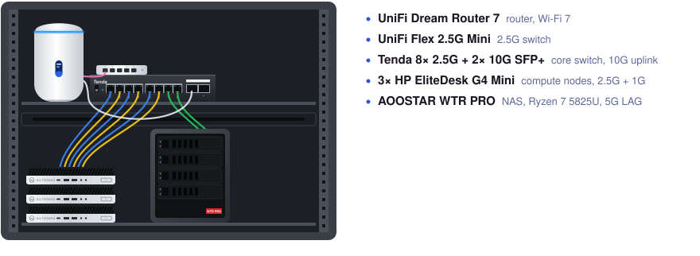

<picture>
  <source media="(prefers-color-scheme: dark)" srcset="https://raw.githubusercontent.com/kriakiku/kriakiku/output/hero-dark.svg">
  
</picture>

<a href="https://savelife.in.ua/dronopad/main-eng.html"><picture>
  <source media="(prefers-color-scheme: dark)" srcset="https://raw.githubusercontent.com/kriakiku/kriakiku/output/ukraine-dark.svg">
  
</picture></a>

## Projects

<a href="https://github.com/holtdroid"><picture>
  <source media="(prefers-color-scheme: dark)" srcset="https://raw.githubusercontent.com/kriakiku/kriakiku/output/plaque-holtdroid-dark.svg">
  
</picture></a>
<a href="https://github.com/holtkeeper"><picture>
  <source media="(prefers-color-scheme: dark)" srcset="https://raw.githubusercontent.com/kriakiku/kriakiku/output/plaque-holtkeeper-dark.svg">
  
</picture></a>
<a href="https://favicons.page"><picture>
  <source media="(prefers-color-scheme: dark)" srcset="https://raw.githubusercontent.com/kriakiku/kriakiku/output/plaque-favicons-dark.svg">
  
</picture></a>
<a href="https://github.com/kriakiku/eventide-card"><picture>
  <source media="(prefers-color-scheme: dark)" srcset="https://raw.githubusercontent.com/kriakiku/kriakiku/output/plaque-eventide-dark.svg">
  
</picture></a>

## Activity

<picture>
  <source media="(prefers-color-scheme: dark)" srcset="https://raw.githubusercontent.com/kriakiku/kriakiku/output/stats-dark.svg">
  
</picture>

## My Homelab

<picture>
  <source media="(prefers-color-scheme: dark)" srcset="https://raw.githubusercontent.com/kriakiku/kriakiku/output/homelab-dark.svg">
  
</picture>

