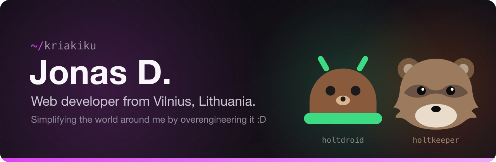
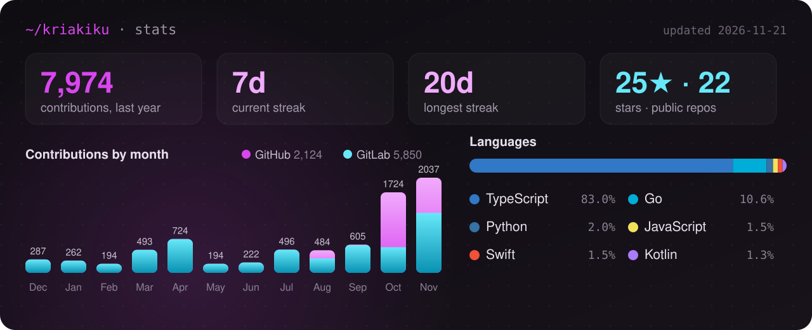

  

Hi, I'm Jonas, a web developer from Vilnius. Besides web apps I build tools for everyday chores:
testing APKs on real Androids, keeping a fleet of repositories updated, reviewed and released,
showing website icons that look right in any theme, and a calendar for my Home Assistant dashboard.

## Projects

<a href="https://github.com/holtdroid"><picture>
  <source media="(prefers-color-scheme: dark)" srcset="https://raw.githubusercontent.com/kriakiku/kriakiku/output/plaque-holtdroid-dark.svg">
  
</picture></a>
<a href="https://github.com/holtkeeper"><picture>
  <source media="(prefers-color-scheme: dark)" srcset="https://raw.githubusercontent.com/kriakiku/kriakiku/output/plaque-holtkeeper-dark.svg">
  
</picture></a>
<a href="https://favicons.page"><picture>
  <source media="(prefers-color-scheme: dark)" srcset="https://raw.githubusercontent.com/kriakiku/kriakiku/output/plaque-favicons-dark.svg">
  
</picture></a>
<a href="https://github.com/kriakiku/eventide-card"><picture>
  <source media="(prefers-color-scheme: dark)" srcset="https://raw.githubusercontent.com/kriakiku/kriakiku/output/plaque-eventide-dark.svg">
  
</picture></a>

## Activity

  

  <picture>
    <source media="(prefers-color-scheme: dark)" srcset="https://raw.githubusercontent.com/kriakiku/kriakiku/output/snake-dark.svg">
    
  </picture>

## Also here

- [adhd-imap-sync](https://github.com/kriakiku/adhd-imap-sync) — goimapnotify and fetchmail in a tiny Alpine container: mail lands in your local MDA the moment it arrives.
- Homelab as code: [homelab.nixos](https://github.com/kriakiku/homelab.nixos) · [homelab.k8s](https://github.com/kriakiku/homelab.k8s) · [homelab.ha](https://github.com/kriakiku/homelab.ha) · [homelab.temporal](https://github.com/kriakiku/homelab.temporal) · [dotfiles](https://github.com/kriakiku/dotfiles)
- macOS: [MeetCallRecorder](https://github.com/kriakiku/MeetCallRecorder) · [speakr-asr-wrapper](https://github.com/kriakiku/speakr-asr-wrapper)

Widgets are rendered every night by this repository's own workflow: <code>scripts/render.py</code> draws the project plaques with today's date, <code>scripts/stats.py</code> combines GitHub with daily totals from the public GitLab calendar, and <a href="https://github.com/Platane/snk">Platane/snk</a> draws the snake over the result.
